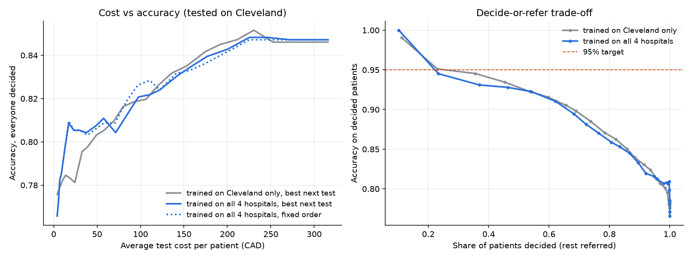

# Which heart test next? Cost-aware triage for coronary artery disease

Most heart-disease ML projects train one classifier on all 13 features and report accuracy.
Real doctors don't order every test for every patient: a thallium scan costs ~25x the intake.
This project asks **how few (and which) tests are needed before a diagnosis is safe**, and
refers the patient onward when the model can't be confident.

Data: UCI Heart Disease (1988), 920 patients from 4 hospitals, plus the test prices from the
dataset's own `costs/` folder (Ontario fee schedule, CAD, group discounts applied).

| Stage | Features | Cost |
|---|---|---|
| intake | age, sex, chest pain type, resting BP | $4.00 |
| bloods + resting ECG | cholesterol, fasting sugar, resting ECG | $25.87 |
| exercise ECG | exercise angina, ST depression, ST slope | $89.30 |
| fluoroscopy | vessels coloured (`ca`) | $100.90 |
| thallium scan | max heart rate, thallium result | $103.90 |
| **full workup** | | **$323.97** |

## Method
1. **One logistic model per set of known tests**, trained only on patients who had exactly those
   tests recorded. Missing tests are treated as *not done*, never imputed into a result.
   (Logistic regression beat random forest and gradient boosting: 84.0% vs 83.3% vs 81.7%.)
2. **Best next test per patient:** for each remaining test, estimate the expected drop in error
   from the 25 training patients whose current probability is closest, divided by its price.
3. **Stop** when the model is ≥ `conf` sure either way. If every available test is done and it's
   still unsure, **refer** instead of guessing.
4. `conf` is picked on training data only (out-of-fold, averaged over 3 CV shuffles) as the lowest
   threshold that gives 95% accuracy on decided patients.

All numbers below are cross-validated (5-fold x3, tested on Cleveland) unless noted.

## Results



| Strategy | Accuracy | Avg cost / patient |
|---|---|---|
| Intake only, everyone decided | 77.6% | $4 |
| All tests, everyone decided | **84.6% ± 3.6** | $324 |
| Best next test, within 1 pt of all tests | 84.2% | **$175** (fixed cheapest-first order: $200) |
| **Decide-or-refer** | **95.2%** (95% CI 91.8–97.2) on the **27%** decided; 73% referred | $290 |

- **Stopping early saves money:** within 1 pt of all-tests accuracy for ~46% less spend.
- **Per-patient test choice is not a proven win.** At the 1-pt mark it costs $177 vs $200 for a
  fixed cheapest-first order, but the two curves overlap almost everywhere else (left chart,
  dotted vs solid). The saving comes from stopping early, not from reordering tests.
- **95% only holds on the patients it decides.** Deciding more patients costs accuracy
  (right chart): ~90% at 65% coverage, ~95% at ~27%.

### Does it transfer to other hospitals? (leave-one-hospital-out)

| Test on | Trained on | Disease rate | Always-majority | Accuracy | AUC |
|---|---|---|---|---|---|
| Cleveland | other 3 | 46% | 54.1% | 76.9% | 0.849 |
| Hungarian | other 3 / Cleveland | 36% | 63.9% | 84.4% / 84.4% | 0.895 / 0.892 |
| VA Long Beach | other 3 / Cleveland | 74% | 74.5% | 73.5% / 75.5% | 0.741 / 0.742 |
| Switzerland | other 3 / Cleveland | 93% | 93.5% | 74.0% / 74.8% | 0.720 / 0.726 |

- **Pooling the 4 hospitals didn't help** (84.7% vs 84.6% on Cleveland). Fluoroscopy was recorded
  almost only at Cleveland, and Swiss never recorded cholesterol, so extra hospitals add little
  usable signal.
- **Hungarian transfers; VA and Switzerland don't.** On those two the model is no better than
  always guessing the majority class (AUC ~0.73), and at the 95% threshold it decides only 1–7% of
  patients, so nearly everyone is correctly referred rather than confidently misdiagnosed.
- An earlier version re-estimated each hospital's disease rate from unlabeled predictions
  (Saerens EM). It overshot (VA: estimated 100% vs actual 74%) and was dropped.

## Limitations
- 303 Cleveland patients; ±3–5 points of fold-to-fold noise on every accuracy.
- Data from 1988; the target is angiographic narrowing > 50%, not outcomes.
- Test value is estimated from similar *probabilities*, not similar patients (`ponytail:` note in code).
- Why not 95% for everyone: honest results on this data top out around 85–88%. Many online 95–99%
  claims use Kaggle's 1,025-row `heart.csv`, which is these ~300 patients duplicated, so identical
  rows land in both train and test.
- A research prototype, not a medical device.

## Run
```
pip install -r requirements.txt
python triage.py                   # all experiments, writes results.png (~10 min)
python -m streamlit run app.py     # interactive demo
```

## Data credit
[UCI Heart Disease dataset](https://archive.ics.uci.edu/dataset/45/heart+disease) (CC BY 4.0),
donated by David W. Aha. Principal investigators, as the donors request:
Andras Janosi, M.D. (Hungarian Institute of Cardiology, Budapest);
William Steinbrunn, M.D. (University Hospital, Zurich);
Matthias Pfisterer, M.D. (University Hospital, Basel);
Robert Detrano, M.D., Ph.D. (V.A. Medical Center, Long Beach and Cleveland Clinic Foundation).
Test costs: Peter Turney (1995), from the Ontario Health Insurance Program fee schedule.
